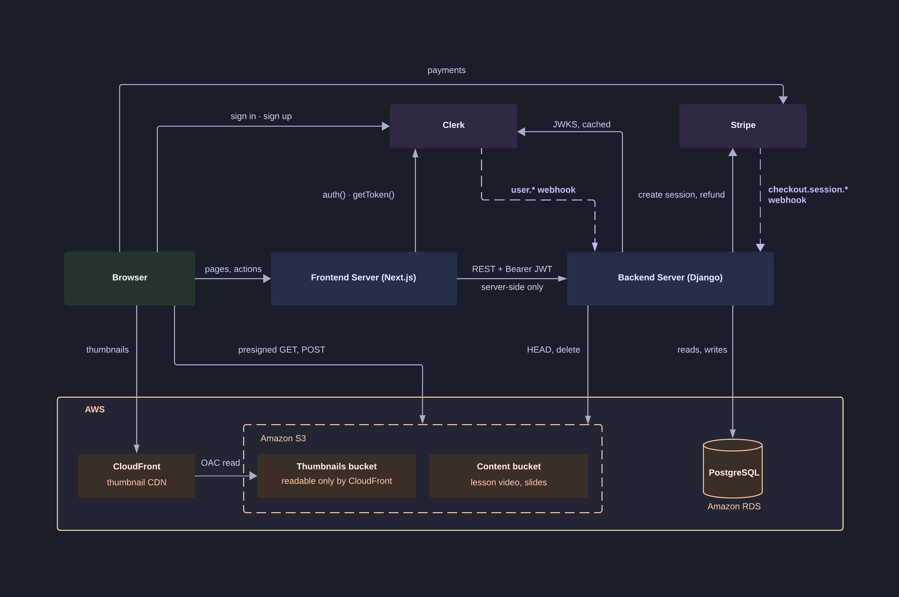

## High-level Architecture



## Repo layout

```
.
├── api/            # Django backend
├── web/            # Next.js frontend
│   ├── app/        # App Router pages and layouts
│   ├── components/ # shared ui components
│   ├── lib/        # server side Django client and helpers
│   ├── public/     # assets
├──SPEC.md          # feature spec, grouped by page
├──SCHEMA.md        # database schema
└──DESIGN.md        # frontend design
```

## Dev Setup

### Prerequisites

- Python 3.13
- PostgreSQL 18+
- Node.js 20.9+ (npm)
- A Clerk application (for anything beyond the health check)

### Backend

All backend commands run from `api/`.

#### 1. Virtualenv

```bash
cd api
python3 -m venv .venv
.venv/bin/pip install -r requirements.txt -r requirements-dev.txt
```

`requirements-dev.txt` holds the test and lint tools; production installs only
`requirements.txt`.

#### 2. Environment

```bash
cp .env.example .env
```

Fill in `.env`. At minimum you need `DJANGO_SECRET_KEY` and `DATABASE_URL`;
the Clerk, AWS and Stripe values are needed once you touch authenticated
endpoints, media or checkout. Generate a dev secret key with:

```bash
.venv/bin/python -c "from django.core.management.utils import get_random_secret_key as k; print(k())"
```

#### 3. Database

PostgreSQL must be running and the database created before migrating:

```bash
sudo service postgresql start           # WSL: no systemd
sudo -u postgres createuser -s "$USER"  # once, if your role doesn't exist
createdb gts_neuro
```

That role has no password and is reached over the local socket, so in `.env`:

```bash
DATABASE_URL=postgres:///gts_neuro
```

Then:

```bash
.venv/bin/python manage.py migrate
.venv/bin/python manage.py createsuperuser
.venv/bin/python manage.py seed_courses   # optional sample catalog; safe to re-run
```

Give the superuser the email you will sign in to the web app with. Your first
Clerk sign-in links to that row and keeps its admin role; any other email signs
in as a learner, and only an admin can open the web app's `/admin` pages. To
promote an existing account instead, set its role to Admin in Django admin.

`seed_courses` adds three published courses, one draft, and sample learners and
reviews. It creates no enrollments.

#### 4. Clerk

From the Clerk dashboard's *API keys* page, fill in `CLERK_SECRET_KEY`,
`CLERK_JWKS_URL` and `CLERK_ISSUER` (the Frontend API URL, such as
`https://<subdomain>.clerk.accounts.dev`).

Clerk's webhook can't reach `localhost`, so in dev the API creates a user's row
from their session token on first sign-in. That fails unless the token carries
the email. Under *Configure -> Sessions -> Customize session token*, set:

```json
{
  "email": "{{user.primary_email_address}}",
  "name": "{{user.full_name}}",
  "image_url": "{{user.image_url}}"
}
```

Use the session token, not a named JWT template. `CLERK_WEBHOOK_SIGNING_SECRET`
can stay blank; see `api/README.md` to exercise the webhook through a tunnel.

#### 5. Storage (S3 and CloudFront)

Needed for uploads: thumbnails, lesson video and slides. Dev uses
real buckets of its own, never production's. Do this in the AWS console, all
in one region.

**Buckets.** Create two buckets, such as `gts-neuro-dev-private` (lesson
video and slides) and `gts-neuro-dev-thumbnails`. Leave *Block all public
access* on and ACLs disabled on both.

**CORS.** The browser uploads straight to S3, so on each bucket, under
*Permissions → Cross-origin resource sharing*:

```json
[
  {
    "AllowedOrigins": ["http://localhost:3000"],
    "AllowedMethods": ["POST"],
    "AllowedHeaders": ["*"],
    "MaxAgeSeconds": 3000
  }
]
```

**CloudFront.** Create a distribution whose origin is the thumbnail bucket
(the bucket itself, not a website endpoint). Under *Origin access*, choose
*Origin access control settings* and create a control that signs requests.
Redirect HTTP to HTTPS, and keep the default *CachingOptimized* policy.

**Thumbnail bucket policy.** Only that distribution may read the bucket.
CloudFront offers this policy after creating the distribution; under the
bucket's *Permissions → Bucket policy* it reads:

```json
{
  "Version": "2012-10-17",
  "Statement": [
    {
      "Effect": "Allow",
      "Principal": { "Service": "cloudfront.amazonaws.com" },
      "Action": "s3:GetObject",
      "Resource": "arn:aws:s3:::gts-neuro-dev-thumbnails/*",
      "Condition": {
        "StringEquals": {
          "AWS:SourceArn": "arn:aws:cloudfront::<account-id>:distribution/<distribution-id>"
        }
      }
    }
  ]
}
```

The private bucket gets no policy: only presigned URLs reach it.

**IAM user.** Create a user with no console access, and give it an inline
policy limited to the two buckets:

```json
{
  "Version": "2012-10-17",
  "Statement": [
    {
      "Effect": "Allow",
      "Action": ["s3:GetObject", "s3:PutObject", "s3:DeleteObject"],
      "Resource": [
        "arn:aws:s3:::gts-neuro-dev-private/*",
        "arn:aws:s3:::gts-neuro-dev-thumbnails/*"
      ]
    },
    {
      "Effect": "Allow",
      "Action": "s3:ListBucket",
      "Resource": [
        "arn:aws:s3:::gts-neuro-dev-private",
        "arn:aws:s3:::gts-neuro-dev-thumbnails"
      ]
    }
  ]
}
```

`s3:ListBucket` makes S3 answer 404, not 403, for a missing object, which is
how the API tells an unfinished upload from a permissions problem. Create an
access key for the user (*Application running outside AWS*).

**`.env`.** Fill in `AWS_S3_REGION_NAME`, `AWS_ACCESS_KEY_ID`,
`AWS_SECRET_ACCESS_KEY`, `AWS_PRIVATE_BUCKET_NAME`,
`AWS_THUMBNAIL_BUCKET_NAME`, and `CLOUDFRONT_DOMAIN` (the distribution's
domain, such as `d1234abcd.cloudfront.net`, with no `https://`). If the
buckets are shared with another environment, set `S3_KEY_FOLDER=dev` so dev's
uploads land under `lessons/dev/` and `thumbnails/dev/`.

To check it once both servers are running, sign in as an admin and upload a
thumbnail on a draft course at `/admin/courses/<id>` (the seeded draft, or one
from `/admin/courses/new`): it should appear on the page.

#### 6. Stripe

Needed for checkout and refunds. Dev uses Stripe's test mode.

1. With test mode on, copy the secret key (`sk_test_...`) from *Developers →
   API keys* into `STRIPE_SECRET_KEY`.

1. Install the [Stripe CLI](https://docs.stripe.com/stripe-cli), run
   `stripe login` once, then forward events to the local API:

   ```bash
   stripe listen \
     --events checkout.session.completed,checkout.session.expired,charge.refunded,charge.dispute.created \
     --forward-to localhost:8000/api/webhooks/stripe/
   ```

1. Put the `whsec_...` it prints in `STRIPE_WEBHOOK_SECRET` and restart
   `runserver`. Keep the forwarder running while you test checkout.

`api/README.md` covers payment-method settings and sending test events.

#### 7. Run

```bash
.venv/bin/python manage.py runserver    # http://127.0.0.1:8000
```

- `GET /api/ping/` — liveness only; never touches the database
- `GET /api/health/` — readiness: 503 if the database is unreachable
- `/admin/` — Django admin (superuser password login, unrelated to Clerk)

Settings default to `config.settings.dev`; production sets
`DJANGO_SETTINGS_MODULE=config.settings.prod`.

#### Tests

```bash
.venv/bin/python -m pytest
```

pytest builds a throwaway database, so the role in `DATABASE_URL` needs
`CREATEDB`. The superuser role from step 3 already has it; for any other role:

```bash
sudo -u postgres psql -c 'ALTER ROLE <role> CREATEDB;'
```

### Frontend

All frontend commands run from `web/`. The backend must be running first.

#### 1. Dependencies

```bash
cd web
npm install
```

#### 2. Environment

```bash
cp .env.local.example .env.local
```

Fill in `NEXT_PUBLIC_CLERK_PUBLISHABLE_KEY` and `CLERK_SECRET_KEY` from the
Clerk dashboard (API keys). Use the same Clerk application as `api/.env`, or
Django will reject the session tokens the frontend sends.

`API_BASE_URL` defaults to `http://127.0.0.1:8000`. It is server-only: the
browser never calls Django directly.

#### 3. Run

```bash
npm run dev                             # http://localhost:3000
```

Keep it on port 3000 — the CORS, CSRF, and Clerk authorized-party settings in
`api/.env` expect that origin.

Other scripts: `npm run build`, `npm run start`, `npm run lint`. See
`web/README.md` for layout and conventions.
